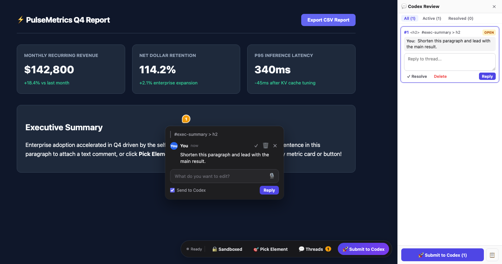

# codex-markup

**Visual HTML reviews for Codex CLI—with browser comments, persistent threads, and live updates.**

Open a local HTML file, highlight text or pick an element, and tell Codex what to change. Feedback stays attached to the page, with replies and resolution status saved beside the HTML.



## Install

Install directly into `~/.codex` (recommended — ~1–2s):

```bash
curl -fsSL https://raw.githubusercontent.com/chkche1/codex-markup/main/install.sh | bash
```

Or via `npx` (auto-relocates permanently to `~/.codex/tools/codex-markup`):

```bash
npx -y github:chkche1/codex-markup install
```

Or from a local checkout (for contributors):

```bash
git clone --depth 1 https://github.com/chkche1/codex-markup.git
cd codex-markup
npm run install-codex
```

**Notes for humans & AI agents:**
- **Requires Node.js >= 22.6.0** (`install.sh` auto-detects Homebrew, `nvm`, `fnm`, `volta`, and `mise`).
- **Zero runtime npm dependencies** — skip `npm install`.
- **Self-verifying & idempotent** — registers `[mcp_servers.inline-review]` in `~/.codex/config.toml`, installs the `inline-html-review` skill and `~/.codex/AGENTS.md` block, runs an MCP smoke test, and exits cleanly. Do **not** run `npm run demo` during install (it starts a foreground server).
- Restart Codex after installing. Verify anytime with `node --no-warnings ~/.codex/tools/codex-markup/src/cli.ts doctor`, or remove cleanly with `uninstall`.

## Why use it?

Codex desktop already includes a browser with visual annotations. `codex-markup` brings a review workflow to Codex CLI and your external browser, with portable review files you can keep in Git. It also works through MCP in Codex desktop.

- **Point to the change:** select text or pick an element to leave a comment with precise page context.
- **Keep the conversation:** reply, resolve, and reopen threads. Reviews live in `<file.html>.comments.json`.
- **Send feedback to Codex:** submit one comment immediately or queue several for a single pass.
- **See updates live:** the preview reloads when the HTML changes, and replies appear in the review UI.

Built for local HTML prototypes, dashboards, and reports. No build step or external runtime dependencies.

## Try the demo

Requires Node.js 22.6 or newer. To have Codex make changes, install Codex CLI and sign in first.

```bash
git clone https://github.com/chkche1/codex-markup.git
cd codex-markup
npm run demo
```

This opens [the example dashboard](examples/demo.html) at `http://127.0.0.1:4321` with the review overlay.

1. Click **Pick Element**, then click part of the page. You can also highlight text to comment on it.
2. Write your feedback. Leave **Send to Codex** checked to send it immediately, or uncheck it to collect comments first.
3. Click **Submit to Codex** when your queued feedback is ready.
4. Watch the preview update and read Codex's replies in the threads.

Submitting feedback works differently depending on how the server is running:

- **Connected Codex session (MCP / `wait`):** feedback returns directly to your active Codex CLI or Codex Desktop session and runs under that session's sandbox permissions. The browser dock displays a read-only **Session Sandbox** badge.
- **Standalone background runs (`serve` / `demo`):** when no session is listening, `codex-markup` launches a local `codex exec` run. For local convenience, standalone unsandboxed servers default to **Full Access** (`--dangerously-bypass-approvals-and-sandbox`), indicated in the dock and CLI startup output. Click the toolbar badge or launch with `--sandbox workspace-write` (or `CODEX_MARKUP_SANDBOX=workspace-write`) to restrict writes to the enclosing Git/project root with no network.
- **Externally sandboxed / policy-restricted hosts:** if the server was launched inside an outer OS sandbox or a managed `/etc/codex/requirements.toml` policy restricts `danger-full-access`, the toolbar locks to a read-only **Host Sandboxed** or **Policy Sandboxed** badge explaining why.

Voice input is available when your browser supports speech recognition.

## Review your own HTML

```bash
node --no-warnings src/cli.ts serve /path/to/page.html
```

The server runs locally on loopback. Comments are saved beside the HTML file; commit the `.comments.json` file to preserve a review, or ignore it for temporary feedback.

## Connect to Codex

Once installed (see [Install](#install) above), restart your Codex session to load `[mcp_servers.inline-review]`, then ask Codex:

> Open page.html for inline review, wait for my comments, and address them.

The integration provides five tools:

| Tool | Purpose |
| --- | --- |
| `open_html_review` | Open an HTML preview with commenting. |
| `wait_for_review` | Wait for submitted feedback. |
| `get_inline_comments` | Read review threads. |
| `reply_to_comment` | Reply and update a thread's status. |
| `resolve_comment` | Resolve or reopen a thread. |

For manual configuration, run `node --no-warnings src/cli.ts setup`. Use `install --codex-home /path/to/config` for a custom Codex configuration directory, `doctor` to verify the MCP handshake, and `uninstall` to cleanly remove the integration.

## Useful commands

Run these from the repository:

```bash
# Read open comments
node --no-warnings src/cli.ts comments /path/to/page.html

# Reply and resolve a thread
node --no-warnings src/cli.ts reply /path/to/page.html c-1 "Updated the spacing." --resolve

# Reopen a thread
node --no-warnings src/cli.ts resolve /path/to/page.html c-1 --reopen

# Run the test suite
npm test
```

## License

[MIT](LICENSE)
